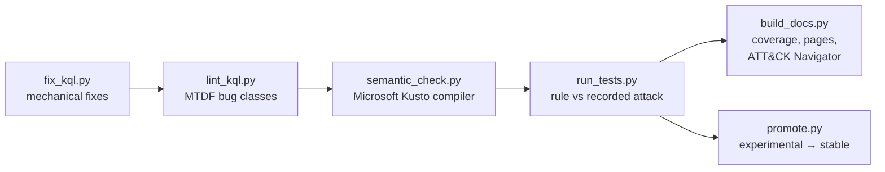

# MTDF Detection Tests

[](https://github.com/azdabat/MTDF-Detection-Tests/actions/workflows/detection-tests.yml)

Detection-as-code validation for the **[Minimum Truth Detection Framework (MTDF)](https://github.com/azdabat/Minimum-Truth-Detection-Framework-ADX-Validated-Composite-Rules)**: composite KQL detections for Microsoft Defender XDR and Sentinel, linted and then tested on every push against **recorded adversary telemetry** from Empire, Covenant and native tooling ([OTRF Security-Datasets](https://github.com/OTRF/Security-Datasets)).

Each detection is anchored on a **minimum truth**: the one observable an attack cannot avoid leaving behind. Each test proves that anchor matches what a real implementation of the technique actually left, and pins the specific malicious event it must catch.

## Coverage

<!-- COVERAGE:START -->
**12 detections** across **5 of 14** ATT&CK tactics · **19** tests passing on recorded adversary telemetry · implementations proven: Covenant, Empire, Native PowerShell, Native cmd, Native schtasks, Sysinternals PsExec  
_Last test run: 2026-11-16 07:28 UTC_

| Tactic | Detection | ATT&CK | Proven against | Status |
|---|---|---|---|---|
| Execution (TA0002) | [Scheduled Task Abuse - Rundll-Aware](detections/execution/scheduled_task_abuse) | [T1053.005](https://attack.mitre.org/techniques/T1053/005/), [T1218.011](https://attack.mitre.org/techniques/T1218/011/), [T1059.001](https://attack.mitre.org/techniques/T1059/001/) | Empire, Native schtasks |  In validation (3/3 passing) |
| Execution (TA0002) | [PowerShell Download Cradle / Stager - Intent-Gated](detections/execution/powershell_intent_first) | [T1059.001](https://attack.mitre.org/techniques/T1059/001/), [T1105](https://attack.mitre.org/techniques/T1105/) | - |  Boundary documented (no passing implementation) |
| Persistence (TA0003) | [Registry Persistence - LSA / Security Support Providers](detections/persistence/registry_lsa_security_providers) | [T1547.009](https://attack.mitre.org/techniques/T1547/009/), [T1112](https://attack.mitre.org/techniques/T1112/) | Empire |  In validation (1/1 passing) |
| Persistence (TA0003) | [Registry Persistence - Scheduled Task Cache & Service ImagePath](detections/persistence/registry_service_taskcache_persistence) | [T1053.005](https://attack.mitre.org/techniques/T1053/005/), [T1543.003](https://attack.mitre.org/techniques/T1543/003/) | Covenant, Empire | In validation (3/3 passing) |
| Persistence (TA0003) | [WMI Fileless Consumer Execution - scrcons Substrate](detections/persistence/wmi_fileless_scrcons_consumer) | [T1546.003](https://attack.mitre.org/techniques/T1546/003/), [T1047](https://attack.mitre.org/techniques/T1047/) | Covenant | In validation (1/1 passing) |
| Credential Access (TA0006) | [LSASS Credential Theft - Master Composite (L3)](detections/credential_access/lsass_credential_theft) | [T1003.001](https://attack.mitre.org/techniques/T1003/001/), [T1003.002](https://attack.mitre.org/techniques/T1003/002/) | Native PowerShell | In validation (1/1 passing) |
| Credential Access (TA0006) | [NTDS / Registry Hive Credential Dumping](detections/credential_access/ntds_credential_dumping) | [T1003.003](https://attack.mitre.org/techniques/T1003/003/), [T1003.002](https://attack.mitre.org/techniques/T1003/002/) | Empire, Native cmd |  In validation (3/3 passing) |
| Lateral Movement (TA0008) | [SMB + Service Execution - PsExec / Impacket Style](detections/lateral_movement/psexec_smb_service_execution) | [T1021.002](https://attack.mitre.org/techniques/T1021/002/), [T1569.002](https://attack.mitre.org/techniques/T1569/002/), [T1543.003](https://attack.mitre.org/techniques/T1543/003/) | Empire, Sysinternals PsExec |  In validation (3/3 passing) |
| Lateral Movement (TA0008) | [WMI Remote Execution - WmiPrvSE Secondary Execution, Victim Side](detections/lateral_movement/wmiprvse_remote_execution) | [T1047](https://attack.mitre.org/techniques/T1047/), [T1059](https://attack.mitre.org/techniques/T1059/) | Empire |  In validation (2/2 passing) |
| Command and Control (TA0011) | [Ingress Tool Transfer - LOLBin Pack](detections/command_and_control/lolbin_ingress_transfer) | [T1105](https://attack.mitre.org/techniques/T1105/) | Native cmd | In validation (1/1 passing) |
| Command and Control (TA0011) | [Ingress Tool Transfer - Native LOLBins](detections/command_and_control/ingress_tool_transfer_native) | [T1105](https://attack.mitre.org/techniques/T1105/) | Native cmd | In validation (1/1 passing) |
| Command and Control (TA0011) | [Ingress Tool Transfer - PowerShell Download Cradle](detections/command_and_control/powershell_download_cradle) | [T1105](https://attack.mitre.org/techniques/T1105/), [T1059.001](https://attack.mitre.org/techniques/T1059/001/) | - | Boundary documented (no passing implementation) |

<details><summary><b>Known coverage boundaries</b> (6) - documented, tested on every build</summary>

- **Ingress Tool Transfer - PowerShell Download Cradle** · `test.yml`: coverage boundary - Empire's stager hides the download inside -enc base64 and its lab C2 is 10.10.10.5 (RFC1918), so the minimum truth (cleartext download intent + external URL) is never visible; needs -enc decoding
- **Ingress Tool Transfer - PowerShell Download Cradle** · `test_empire_sct_regsvr32.yml`: coverage boundary - same encoded stager launched via regsvr32/SCT; download intent hidden in -enc
- **LSASS Credential Theft - Master Composite (L3)** · `test_benign.yml`: convergence counts events (count() > 1), not distinct signal types - routine LSASS handle access by svchost/services crosses the threshold
- **NTDS / Registry Hive Credential Dumping** · `test_empire_ninjacopy.yml`: coverage boundary - Invoke-NinjaCopy reads the raw volume from in-memory PowerShell: no ntdsutil/vssadmin process and no ntds.dit file write to anchor on
- **PowerShell Download Cradle / Stager - Intent-Gated** · `test.yml`: coverage boundary - encoded Empire stager: download intent hidden in -enc base64, lab C2 on RFC1918
- **PowerShell Download Cradle / Stager - Intent-Gated** · `test_empire_uac_fodhelper.yml`: coverage boundary - fodhelper UAC bypass launches the same encoded stager; download intent hidden in -enc

</details>

🗺️ **[Open the coverage map in MITRE ATT&CK Navigator](https://mitre-attack.github.io/attack-navigator/#layerURL=https%3A%2F%2Fraw.githubusercontent.com%2Fazdabat%2FMTDF-Detection-Tests%2Fmain%2Fdocs%2Fattack-navigator-layer.json)** (green = validated in CI, amber = in validation)
<!-- COVERAGE:END -->

## Pipeline



| Stage | What it guarantees |
|---|---|
| **Fix** (`tools/fix_kql.py`) | Mechanical bug classes (short-hive anchors, stray `;`, non-existent functions) are rewritten, never by hand |
| **Lint** (`tools/lint_kql.py`) | The [8 MTDF bug classes](docs/bug-taxonomy.md): dead anchors, phantom columns, convergence by `count()`, unguarded rarity. ERROR fails the build |
| **Compile** (`tools/semantic_check.py`) | Every rule and every test query parses and type-checks with **Microsoft's own Kusto language service**, against the Defender schema. A column Defender doesn't have is an error |
| **Test** (`tools/run_tests.py`) | Each detection fires on the real attack it claims to catch; a regression on a stable test fails the build |
| **Docs** (`tools/build_docs.py`) | The coverage table, every detection page and the Navigator layer are generated from the last run, so they cannot drift from reality |

**Nothing is ingested for a test.** Each test is one self-contained query: fixture tables bound as `let` datatables in front of the unchanged rule, run on an Azure Data Explorer emulator (Kustainer). Details: [methodology](docs/methodology.md).

## Two ways to run a rule

| Mode | Command | Answers |
|---|---|---|
| **Test** | `python tools/run_tests.py` | Does this rule catch *this* attack, every time? |
| **Tenant** | `python tools/hunt_all.py` | How does this rule behave hunting over a whole Defender-shaped database (lab captures plus every recorded attack)? |

`tools/tenant_setup.py` shapes a local Kustainer database into the Defender schema and `tools/ingest_to_adx.py --all-detections` loads every recorded attack into it, so any rule can be pasted into the ADX web UI and run exactly as in Defender Advanced Hunting.

## Repository layout

Detections are grouped by ATT&CK tactic, using the same folder names as OTRF Security-Datasets. Each detection folder is self-contained.

```
MTDF-Detection-Tests/
├── detections/
│   └── <tactic>/                      e.g. persistence, lateral_movement, credential_access
│       └── <detection>/
│           ├── README.md              generated: minimum truth, ATT&CK, tests, last results
│           ├── detection.yml          metadata: title, techniques, minimum truth, data sources
│           ├── <Rule>.kql             the rule (lab build: widened lookbacks, marked // LAB:)
│           ├── test*.yml              one per telemetry source: what it must catch
│           └── fixtures*/             Defender-shaped telemetry, one folder per test
├── production/                        the deployable rules (tools/prod_build.py restores every lookback)
├── docs/
│   ├── methodology.md                 how tests work and what the telemetry can represent
│   ├── lifecycle.md                   the day-to-day engineering loop
│   ├── bug-taxonomy.md                8 bug classes found in review and testing, mapped to lint checks
│   ├── attack-navigator-layer.json    generated ATT&CK Navigator layer
│   └── results.json                   generated: last CI run
├── tools/                             fix, lint, compile, test, convert, scaffold, docs (see tools/README.md)
├── datasets/catalog.yaml              curated OTRF datasets by tactic
├── lab.ps1                            the whole pipeline locally, in one command
├── publish.ps1                        sync, lint, commit, push
├── push_to_github.ps1                 first upload to a new GitHub repository
└── .github/workflows/detection-tests.yml
```

## Run it locally

Requirements: Python 3.10+, Docker. Node.js 18+ for the compile check (optional locally; CI always runs it).

```bash
docker run -d -p 8080:8080 -e ACCEPT_EULA=Y mcr.microsoft.com/azuredataexplorer/kustainer-linux:latest
pip install -r requirements.txt
npm install --prefix tools/semantic

python tools/lint_kql.py detections --no-port
python tools/semantic_check.py
python tools/run_tests.py                                   # every test
python tools/run_tests.py -k lateral_movement               # one tactic
python tools/run_tests.py -k psexec_smb_service_execution/test.yml --out q.kql   # paste into ADX
```

On Windows, `lab.ps1` runs all of it (`-Load` the first time, to build the local tenant). The engineering loop is in [docs/lifecycle.md](docs/lifecycle.md).

## Adding a detection

```bash
python tools/new_detection.py --tactic persistence --name registry_run_keys \
    --rule path/to/Rule.kql --dataset path/to/otrf_dataset.zip --eventid 1,12,13 \
    --technique T1547.001 --title "Registry Run Key Persistence" \
    --minimum-truth "A RegistryValueSet under ...\CurrentVersion\Run" --catches "Run key launching an Empire stager"
```

This creates the folder with the lab build of the rule, `detection.yml`, an experimental `test.yml` and the fixtures. Push it; CI tests it and documents the result. Once it passes: `python tools/promote.py --apply`.

## Note on antivirus

Fixtures contain **real attacker command lines**, including Empire's encoded PowerShell stager, `mimikatz` and `ntdsutil` invocations. They are inert JSON, but endpoint protection may flag them. On a personal lab machine, exclude only the clone folder.

## Attribution

Adversary telemetry: [OTRF Security-Datasets](https://github.com/OTRF/Security-Datasets), Open Threat Research Forge (MIT License). Fixtures are trimmed, schema-converted excerpts; each test links to its source capture.

**Author:** Ala Dabat: Detection Engineering · Threat Hunting · Purple Team · [MTDF](https://github.com/azdabat/Minimum-Truth-Detection-Framework-ADX-Validated-Composite-Rules)
