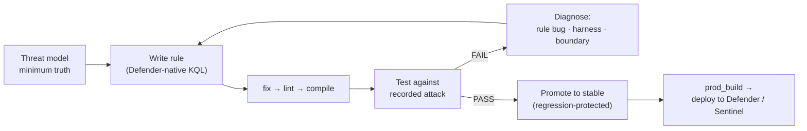

# Engineering lifecycle

How a detection moves from idea to proven, deployed rule. Every step is a command; nothing depends on memory or manual checking.

## 1. Day to day: changing or testing a rule

| Step | Command | Proves |
|---|---|---|
| Fix mechanical bugs | `python tools/fix_kql.py detections --in-place` | Known bug classes are rewritten, reviewed with `git diff` |
| Lint | `python tools/lint_kql.py detections --no-port` | No MTDF bug class remains (ERROR blocks) |
| Compile | `python tools/semantic_check.py` | Parses and type-checks as Defender would, against the Defender schema |
| Test | `python tools/run_tests.py` | Each rule catches the attack it claims to: PASS / FAIL / KNOWN |
| Hunt | `python tools/hunt_all.py` | Behaviour over a whole tenant of mixed data |
| Publish | `publish.ps1 -Message "..."` | CI re-runs everything on a clean engine and regenerates the docs |

On Windows, `lab.ps1` runs fix-free steps 2–5 plus the docs in one command.

## 2. Adding a detection

1. **Threat model first.** Write down the minimum truth: the one observable the technique cannot avoid leaving. If you cannot name it, the rule is not ready.
2. **Find the telemetry.** An OTRF dataset (`datasets/catalog.yaml`) or your own lab capture (`tools/Export-SysmonWindow.ps1` on a lab VM).
3. **Scaffold** with `tools/new_detection.py`: it builds the folder, converts the telemetry to Defender tables, writes `detection.yml` and an experimental test, and makes the lab build (every widened window marked `// LAB: production uses <value>`).
4. **Run the pipeline.** A FAIL is diagnosed into one of three outcomes:
   - **Rule bug**: fix the rule; the failing test is now its regression test.
   - **Harness bug**: fix the converter or schema; re-run every test (the harness is tested too, see methodology §5).
   - **Coverage boundary**: the minimum truth is genuinely absent from this implementation. Record it as `known_issue:` with the reason. It stays in the suite and reports if it ever starts passing.
5. **Promote.** After a passing CI run: `python tools/promote.py --apply`. From then on a regression fails the build.

## 3. Keeping the lab Defender-shaped

The local engine stands in for Defender Advanced Hunting, so its schema must match Defender's.

- The schema lives in one place: `MDE_SCHEMA` in `tools/kql_testkit.py`.
- When the compile check or a hunt reports a column that does not exist, and the column **is** a real Defender column, add one line to `MDE_SCHEMA`. `tools/tenant_setup.py` (step 1a of `lab.ps1`) then adds it to every local table, keeping existing rows.
- If the column is **not** a real Defender column, the rule is wrong (bug class 6, phantom column): fix the rule, not the schema.

## 4. Deploying

`python tools/prod_build.py` writes `production/<Rule>.kql`: the tested rule with every `// LAB:` lookback restored to its production value and nothing else changed. Those files are what goes into Defender custom detections or Sentinel analytics rules.
