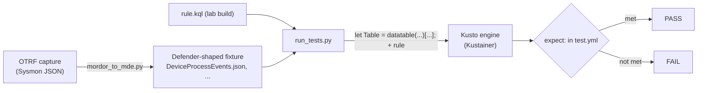

# Methodology

How MTDF detections are tested, what a passing test proves, and what the telemetry can and cannot represent.

## 1. The detection model

Every MTDF composite is built around a **minimum truth**: the one observable an attack cannot avoid leaving behind. Around it sit **reinforcement** signals that raise confidence, and **suppression** of what is known good. A scheduled task registered through COM never runs `schtasks.exe`, but it must write `Schedule\TaskCache`. A PsExec-style service must be started by `services.exe`, shortly after an inbound SMB/RPC connection.

A test therefore asks one precise question: **does the minimum truth, as written in KQL, match what a real adversary left behind?**

## 2. The test harness



**Nothing is ingested.** Each fixture table is bound with a `let` in front of the unchanged rule:

```kusto
let DeviceRegistryEvents = datatable(Timestamp:datetime, DeviceName:string, RegistryKey:string, ...) [ ... ];
// rule body follows, untouched
```

A `let` shadows the real table for that query, so a test is a single self-contained query with no tables to create, no stale rows and no state between runs. Any test can be pasted into the Azure Data Explorer web UI: `python tools/run_tests.py -k <test> --out query.kql`.

**Lab build.** The rule under test differs from production in one respect: time windows that feed `ago()` are widened to `3650d`, so 2019-2020 captures fall inside them (`tools/lab_build.py`; each change is commented `// LAB: production uses 7d`). Correlation windows such as `TimeWindow = 2m` are untouched, so the detection logic is identical.

## 3. Kinds of test

| Kind | Question | Example |
|---|---|---|
| **Attack** | Does the rule fire on the real attack? | Empire PsExec → `services.exe` spawns the stager |
| **Cousin implementation** | Does it catch the *technique*, or one tool? | PsExec rule vs Empire PsExec, Empire SMBExec, Sysinternals PsExec |
| **Regression** | Does a fixed bug stay fixed? | `test_busy_device.yml`: the WMI attack on a device with other web traffic (Bug Class 3) |
| **Benign / precision** | Does it stay silent on normal activity? | LSASS rule vs a capture with no credential theft |
| **Coverage boundary** | Where does the minimum truth stop? | NinjaCopy reads the raw volume: no process or file anchor exists |

**Assertions** in `test.yml` pin the specific malicious event, not just "some rows came back": `contains` (fields that must appear in one row), `not_contains`, `row_count`, `min_rows`, `columns`.

## 4. Maturity lifecycle

| Maturity | Meaning | Effect on the build |
|---|---|---|
| `experimental` | New or not yet proven on the engine | Reported, never blocks |
| `stable` | Passed and reviewed | A regression fails the build |
| `known_issue: "<why>"` | Documented defect or coverage boundary | Reported as KNOWN; reports when it starts passing |

New tests start `experimental`. After a CI run, `python tools/promote.py --apply` promotes those that passed. The CI badge therefore means *the stable suite passes*, and the README shows every test's last result.

## 5. Telemetry and fidelity

Adversary telemetry comes from [OTRF Security-Datasets](https://github.com/OTRF/Security-Datasets): Sysmon and Windows event logs recorded while Empire, Covenant and native tools carried out ATT&CK techniques in a small Active Directory lab. [`tools/mde_mapping.py`](../tools/mde_mapping.py) reshapes Sysmon into Defender Advanced Hunting tables.

| Sysmon | Defender table | Fidelity |
|---|---|---|
| 1 process create | `DeviceProcessEvents` | Clean: command lines, parent, hashes, integrity, account |
| 3 network | `DeviceNetworkEvents` | Clean; inbound (`Initiated=false`) maps local/remote from the destination side |
| 7 image load | `DeviceImageLoadEvents` | Clean |
| 11, 23, 26 file | `DeviceFileEvents` | Clean |
| 12, 13, 14 registry | `DeviceRegistryEvents` | Clean; hive written as `HKEY_LOCAL_MACHINE\...` as Defender does |
| 8, 10, 19-21, 22 | `DeviceEvents` | Approximate: best-effort `ActionType`, details in `AdditionalFields` |

**Writer reputation** (`InitiatingProcessSHA256`, `...VersionInfoCompanyName`) is filled from the writing process's own process-create event when it falls inside the capture. Otherwise it is empty, as Defender shows for a process that started before collection.

**The harness is tested too.** The PsExec tests first showed no inbound SMB/RPC connection in any capture. The cause was a mapper bug: for inbound connections Sysmon records the remote side as `Source`, and the mapper had treated `Source` as local. It was fixed before any rule was judged on that data.

## 6. Limits of the evidence

- **Lab C2 is internal.** OTRF's Empire server sits on `10.10.10.5`. Rules that rightly suppress RFC1918 destinations cannot see its download URLs; in a real intrusion the C2 is external.
- **Captures are minutes long.** Behaviours that need hours of history (beacon timing, rarity baselines) need a longer capture from a lab.
- **One small domain.** Prevalence and rarity signals are not representative of an enterprise.
- **Sysmon is not Defender.** Defender-only signals (for example `ActionType` values with no Sysmon equivalent) are approximated or absent.

A pass proves the rule's logic matches this implementation of the technique in this telemetry. It does not prove a production false-positive rate; benign tests and tenant tuning do that.
